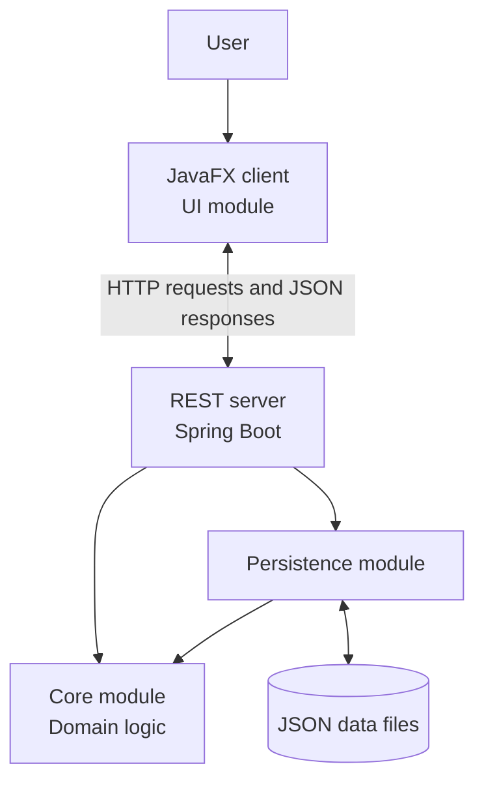

# Dinnertracker

[Open Dinnertracker in Eclipse Che](https://che.iaas.ntnu.no/#https://git.ntnu.no/IT1901-2026-groups/gr2631)


This repository contains the source code and documentation for the Dinnertracker project, developed as part of the IT1901 course at NTNU.

Dinnertracker is a dinner planning application that helps users manage recipes and keep track of the ingredients available in their fridge.

Users can create an account and log in, manage recipes, and maintain a personal fridge. The application uses a JavaFX client that communicates with a REST server, separating the user interface from the application's core logic and data persistence.

For more information about the application and its functionality, see the [Dinnertracker README](dinnertracker/README.md).


## Repository structure

The actual Dinnertracker application is located in the
[`dinnertracker/`](dinnertracker/) directory. It is organized as a
multi-module Maven project consisting of four architectural modules:

    gr2631/
    ├── dinnertracker/
    │   ├── core/
    │   ├── persistence/
    │   ├── rest/
    │   ├── ui/
    │   ├── data/
    │   ├── README.md
    │   └── pom.xml
    ├── docs/
    │   ├── release1/
    │   ├── release2/
    │   └── release3/
    |   └── ai-tools.md
    ├── .gitignore
    └── README.md

The modules have the following responsibilities:

- **`core/`** – contains the application's domain classes, core logic, and their tests.
- **`persistence/`** – handles loading and saving application data.
- **`rest/`** – provides REST API endpoints using Spring Boot.
- **`ui/`** – contains the JavaFX graphical user interface.


The repository also contains application data, screenshots and project documentation located in the [`docs/`](docs/) directory.


## Architecture

Dinnertracker uses a client-server architecture. The JavaFX client communicates with the REST server using HTTP requests and JSON. The server connects the API to the core domain logic and persistence layer.




This separation allows the client to interact with application functionality through the REST API instead of directly handling server-side operations. The `core` module contains the domain logic, while the `persistence` module is responsible for storing and retrieving data. The `core` module is independent of the `UI` and `persistence` modules. This separation keeps the domain logic independent of the graphical interface and file handling. The JavaFX client uses the `DinnertrackerRestClient` class to send HTTP requests to the server, and does not read or write the data files directly.

More detailed information about the architecture and design can be found in the [Release 3 documentation](docs/release3/).


## Requirements

The project uses the following technologies and tools:

- Java 17
- Apache Maven 3.9.x
- JavaFX 21.0.2
- Spring Boot 3.5.7
- Jackson for JSON processing
- JUnit 5 for automated testing
- JaCoCo for test coverage
- Checkstyle for code style checks
- SpotBugs for static analysis
- Spotless for Java formatting

The project dependencies and module configuration are defined in the Maven `pom.xml` files.


## Building and testing

Run the Maven commands from the `dinnertracker/` directory unless otherwise specified.

### Build the project

From the repository root, run:

```bash
cd dinnertracker
mvn clean install
```


### Run tests

To compile the project and run the tests:

```bash
mvn test
```

### Build the project
```bash
mvn package
```

### Run verification and code quality checks

To run the verification phase, including the configured tests, code quality checks and test coverage checks:

```bash
mvn verify
```

To generate JaCoCo coverage reports:

```bash
mvn jacoco:report
```

The available reports depend on the modules and their JaCoCo configuration. The aggregated report, when generated, can be found under the root project's `target/site/` directory.

The configuration and requirements for testing and code quality are documented in [code-quality.md](docs/release3/code-quality.md).


## Running the application

The REST server must be running before the JavaFX client can communicate with it.

### Start the REST server
Open a terminal from the repository root and run:

```bash
cd dinnertracker/rest
mvn spring-boot:run
```

The server is configured to start on port `7070`. The `/health` endpoint can be used to check whether the server is running. 


### Start the JavaFX client

Keep the REST server running and open a second terminal from the repository root:

```bash
cd dinnertracker/ui
mvn javafx:run
```

The JavaFX client communicates with the REST server to access application functionality.


## Eclipse Che

The project is configured to support development using Eclipse Che.

The project can be opened in Eclipse Che using the following link:

[Open Dinnertracker in Eclipse Che](https://che.iaas.ntnu.no/#https://git.ntnu.no/IT1901-2026-groups/gr2631)

During Release 1, the group encountered problems when setting up and running the project in Eclipse Che. We documented the issue and worked on resolving it.

The Eclipse Che setup has since been resolved, and the project can be opened in the Eclipse Che environment.

## Documentation

Documentation for the project is located in the `docs/` directory.

Documentation from Release 1 can be found in [docs/release1](docs/release1/).

Documentation for Release 2 can be found in [docs/release2](docs/release2/).

Documentation for Release 3 can be found in [docs/release3](docs/release3/).
