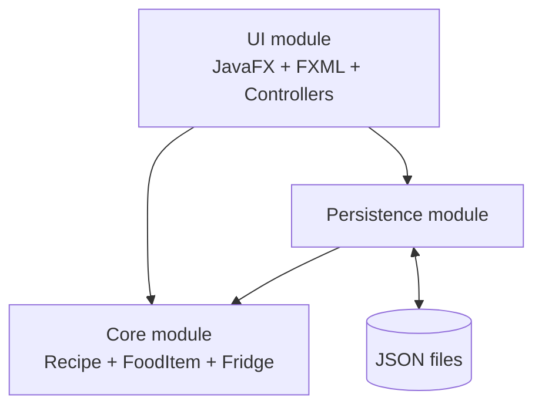

# Dinnertracker

This repository contains the source code and documentation for the Dinnertracker project, developed as part of IT1901 at NTNU.

Dinnertracker is a dinner planning application that helps users manage recipes and keep track of the ingredients available in their fridge.

For more information about the application and its functionality, see the [Dinnertracker README](dinnertracker/README.md).


## Repository structure

The actual Dinnertracker application is located in the
[`dinnertracker/`](dinnertracker/) directory. It is organized as a
multi-module Maven project consisting of three architectural layers:

- [`core/`](dinnertracker/core/) – contains the domain classes and their tests.
- [`persistence/`](dinnertracker/persistence/) – handles saving application data.
- [`ui/`](dinnertracker/ui/) – contains the JavaFX user interface.
- [`data/`](dinnertracker/data/) – contains application data files.

Project documentation is located in the [`docs/`](docs/) directory.

The repository is structured as follows:

```text
gr2631/
├── dinnertracker/
│   ├── core/
│   ├── persistence/
│   ├── ui/
│   ├── data/
|   ├── README.md
│   └── pom.xml
│
├── docs/
│   └── release1/
|   └── release2/
│
├── .gitignore
└── README.md
```

## Architecture

Dinnertracker is structured as a modular three-layer application. The graphical user interface, core domain logic and persistence functionality are separated into different Maven modules.



The `ui` module depends on both the `core` and `persistence` modules. The `persistence` module depends on the `core` module because it stores and loads objects from the domain model.

The `core` module is independent of the UI and persistence modules. This separation keeps the domain logic independent of the graphical interface and file handling.

More detailed information about the architecture can be found in [architecture.md](docs/release2/architecture.md).


## Requirements

The project requires:

- Java 17
- Apache Maven 3.9.12
- JavaFX 21.0.2

The project also uses the following main libraries and tools:

- JavaFX and FXML for the graphical user interface
- Jackson for JSON persistence
- JUnit for testing
- JaCoCo for measuring test coverage
- Checkstyle for code style checking
- SpotBugs for static analysis
- Spotstyle for styling conventions

The project dependencies and module configuration are defined in the Maven `pom.xml` files.


## Building and testing

Maven is used to build the project and run the test suite.

All Maven commands below should be run from the `dinnertracker/` directory:

```bash
cd dinnertracker
```

### Run tests

To compile the project and run the tests:

```bash
mvn test
```

### Build the project

To compile and package the project:

```bash
mvn package
```

### Run the application

To start the JavaFX application:

```bash
cd ui
mvn javafx:run
```

### Run verification and code quality checks

To run the Maven verification stage, including the configured tests, code quality checks and test coverage:

```bash
mvn verify
```

A JaCoCo report can also be generated with:

```bash
mvn jacoco:report
```

The configuration and requirements for testing and code quality are documented in [code-quality.md](docs/release2/code-quality.md).

## Eclipse Che

The project is configured to support development using Eclipse Che.

The project can be opened in Eclipse Che using the following link:

[Open Dinnertracker in Eclipse Che](https://che.iaas.ntnu.no/#https://git.ntnu.no/IT1901-2026-groups/gr2631)

During Release 1, the group encountered problems when setting up and running the project in Eclipse Che. We documented the issue and worked on resolving it.

The Eclipse Che setup has since been resolved, and the project can be opened in the Eclipse Che environment.

## Documentation

Documentation for the project is located in the `docs/` directory.

Documentation from Release 1 can be found in [docs/release1](docs/release1/).

Documentation for Release 2 can be found in [docs/release2](docs/release2/).

The Release 2 documentation includes:

- [Release 2](docs/release2/release2.md)
- [Architecture](docs/release2/architecture.md)
- [Persistence](docs/release2/persistence.md)
- [Work Practices](docs/release2/work-practices.md)
- [Workflow](docs/release2/workflow.md)
- [Code Quality](docs/release2/code-quality.md)
- [Teamwork](docs/release2/teamwork.md)
- [AI Tools](docs/release2/ai-tools.md)


