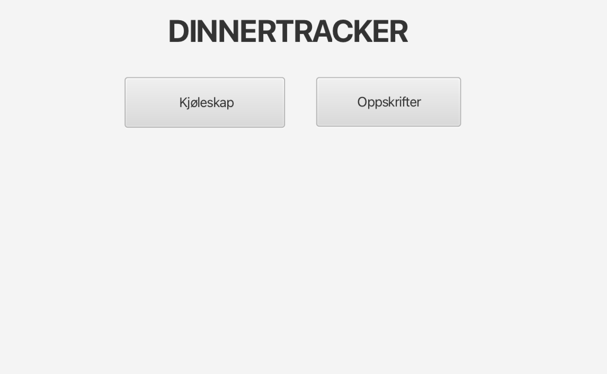

# Dinnertracker

## About the application

Dinnertracker is a dinner planning application designed to help users
keep track of the ingredients they have available and manage their
dinner recipes.

The application allows users to keep an overview of the food in their
fridge and save their own recipes. The long-term goal is to make it
easier to plan dinners based on the ingredients available to the user.

The application is being developed as part of the IT1901 course at NTNU.

## Application screenshot



*Screenshot of the Dinnertracker application - homepage.*


*Screenshot of the Dinnertracker application - fridge page.*


*Screenshot of the Dinnertracker application - recipes page.*


## User stories

### User story 1 – Adding a recipe

> As a user, I want to add a recipe with a name and ingredients, so that
> I can save my own dinner recipes.

### User story 2 – Managing fridge ingredients

> As a user, I want to add ingredients to my fridge, so that I can keep
> an overview of the ingredients I have available.

## Application architecture

Dinnertracker is organized as a multi-module Maven project with three
main architectural layers:

- **Core** – contains the domain logic and central concepts of the
  application, such as recipes, food items, and the fridge.
- **Persistence** – handles saving and loading application data using
  JSON files.
- **UI** – contains the graphical user interface, implemented using
  JavaFX and FXML.

The modules are located in the following directories:

```text
dinnertracker/
├── core/
├── persistence/
├── ui/
├── data/
└── pom.xml
```

The overall `pom.xml` manages the three modules, while each module has
its own `pom.xml` containing its module-specific configuration and
dependencies.

## Technologies

The project uses:

- **Java 17**
- **Maven**
- **JavaFX 21.0.2**
- **FXML**
- **JUnit**

Java and JavaFX versions, as well as the project dependencies, are
configured in the Maven `pom.xml` files.

## Running the project

### Requirements

To build and run Dinnertracker, you need:

- Java 17 or later
- Maven

### Run tests

From the `dinnertracker/` directory, run:

```bash
mvn test
```

This runs the automated tests for the project modules.

### Run the application

To start the JavaFX application, run:

```bash
mvn javafx:run
```

## Application data

Application data is stored in the [`data/`](data/) directory.

The project currently contains a `recipes.json` file for recipe data.

## Development environment

The project is configured to support development using Eclipse Che.

More information about opening and running the project in Eclipse Che
will be provided here:

[Eclipse Che project](INSERT-LINK-HERE)

## Project documentation

Documentation for the individual releases is located in the
[`docs/`](../docs/) directory.

The documentation for Release 1 can be found
[here](../docs/release1/release1.md).
