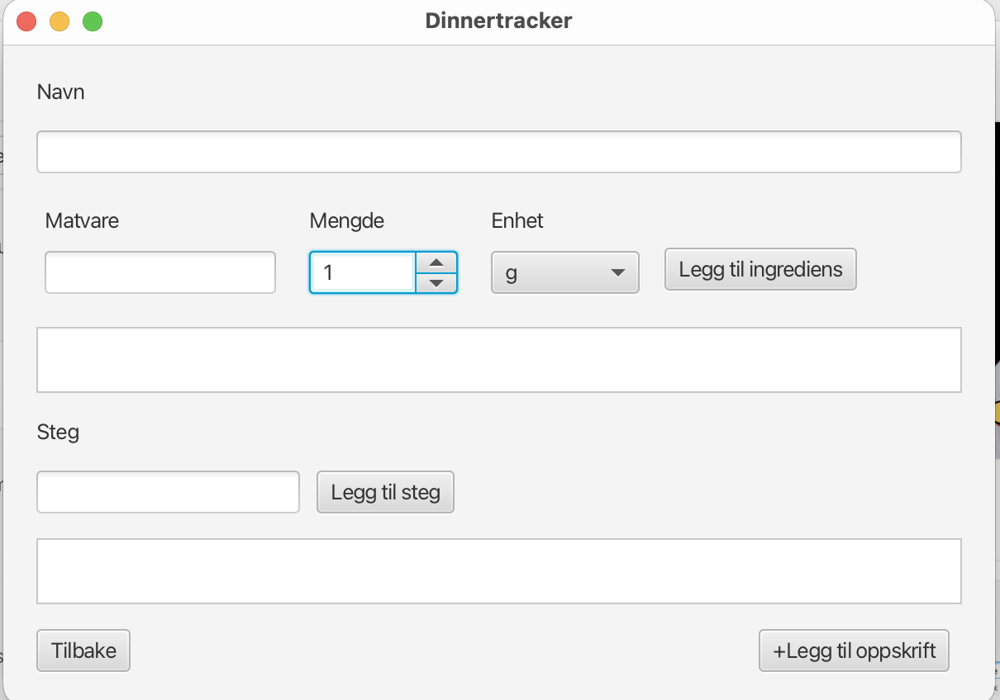
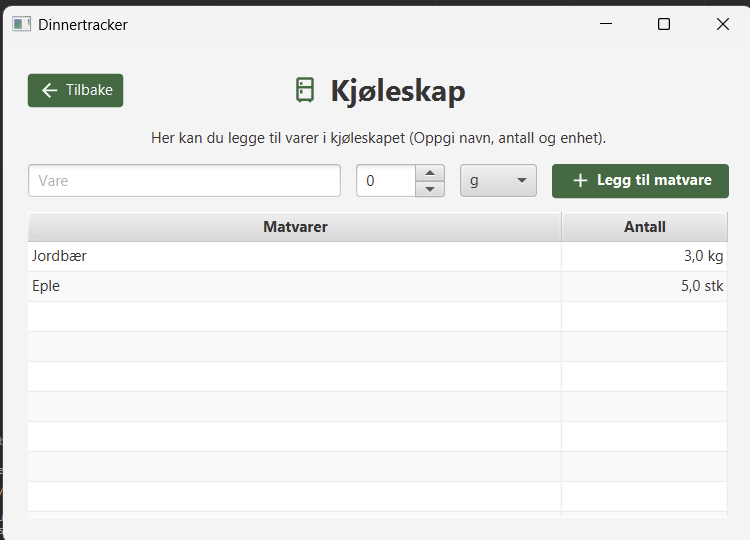
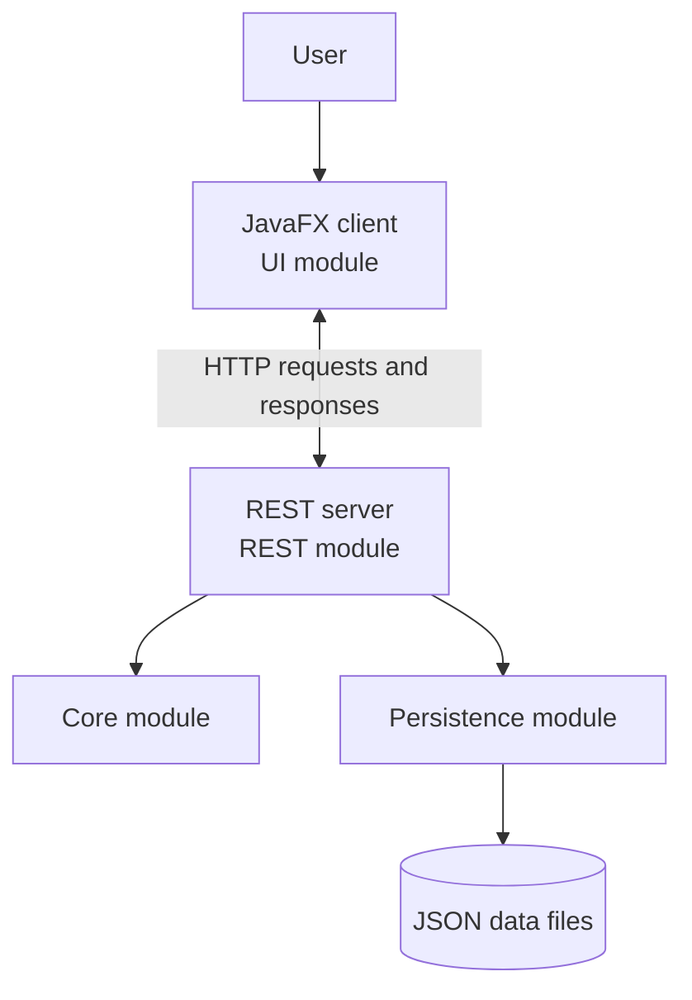

# Dinnertracker

## About the application

Dinnertracker is a dinner planning application developed as part of the IT1901 course at NTNU. It helps users manage dinner recipes and keep track of ingredients available in their fridge. 

The application supports user accounts, login, recipe management, and personal fridge management. Each user can manage their own fridge and the recipes available through the application

Dinnertracker is developed in Java and uses JavaFX for the graphical user interface, a REST server for communication between the client and server, and JSON-based persistence for application data.


## Application screenshot

The screenshots below show the application's user interface. They will be updated soon så fort som mulig hehe. 


*Screenshot of the Dinnertracker application - login page.*


*Screenshot of the Dinnertracker application - homepage.*


*Screenshot of the Dinnertracker application - recipes page.*




*Screenshot of the Dinnertracker application - add recipe page.*




*Screenshot of the Dinnertracker application - fridge page.*


## Functionality and user stories

### User story 1 – Adding a recipe

> As a user, I want to add a recipe with a name and ingredients, so that
> I can save my own dinner recipes.


### User story 2 – Managing fridge ingredients

> As a user, I want to add ingredients to my fridge, so that I can keep
> an overview of the ingredients I have available.


### User story 3 - Detailed view of recipes

> As a user, I want to view an overview of all available recipes, as well as click into a specific recipe, so that I can easily see which ingredients are needed and which steps to follow to prepare the meal.


### User story 4 - Sorting based on fridge ingredients

> As a user, I want to sort the recipes based on the food items I have in my refrigerator, so that I can use ingredients I already own, reduce food waste, and quickly figure out what to make for dinner.


### User accounts and login

Users can create an account and log in to the application. The application keeps track of the logged-in user so that user-specific functionality can be provided.

### Recipe management

Users can manage dinner recipes and their ingredients, making it easier to keep track of possible meals. Dinnertracker also sorts recipes by the proportion of ingredients available in the user's fridge, prioritizing recipes that can be prepared with the ingredients they already have. 

### Personal fridge

Each user has their own fridge, where they can manage the ingredients they have available. This provides an overview of available ingredients when planning meals.


## Application architecture

Dinnertracker is organized as a multi-module Maven project. The application separates the graphical user interface, REST API, core logic, and persistence.

The main modules have the following responsibilities:

- **`ui/`** – contains the graphical user interface implemented using JavaFX and FXML.
- **`rest/`** – provides the REST API used for communication between the client and server.
- **`core/`** – contains the application's domain model and core logic.
- **`persistence/`** – handles loading and saving application data.
- **`data/`** – contains application data files.

The intended client-server architecture is illustrated below:



The JavaFX client communicates with the REST server, which connects incoming requests to the application's core logic and persistence layer.

More detailed information about the architecture and design can be found in the [Release 3 documentation](../docs/release3/).


## Building and testing

Dinnertracker uses Maven to manage dependencies, build the application, and run automated tests. 

From the `dinnertracker/` directory, run the following commands.

### Run tests

```bash
mvn test
```

### Verify the project

```bash
mvn verify
```

The verification phase runs the configured tests and code quality checks. It also checks the configured test coverage requirements.

### Generate JaCoCo reports

```bash
mvn jacoco:report
```

JaCoCo is used to measure test coverage. The project configuration sets minimum thresholds of:

- 80% line coverage
- 70% branch coverage

The generated reports are available in the relevant modules' `target/site/jacoco/` directories. An aggregated report may also be available under `target/site/jacoco-aggregate/`, depending on the Maven configuration.

## Running the application

The application consists of a JavaFX client and a REST server. The server must be running and accessible to the client for REST-based functionality to work.

The REST server is configured to use port `7070`. The exact startup commands and access to the server should be verified against the final Maven configuration and development environment.

## Development environment

The project uses Maven and is configured for development with Eclipse Che.

For the repository's Eclipse Che setup, see the [root README](../README.md).

## Project documentation

Documentation for the individual releases is located in the [`docs/`](../docs/) directory.

- [Release 1 documentation](../docs/release1/release1.md)
- [Release 2 documentation](../docs/release2/release2.md)
- [Release 3 documentation](../docs/release3/release3.md)
