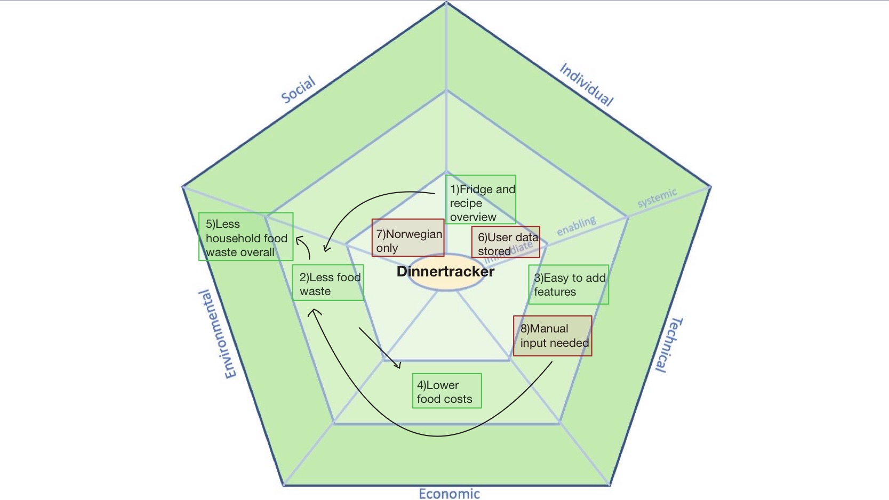

# Sustainability in DinnerTracker

## Introduction
DinnerTracker is a Java application where users log in, register groceries in their fridge and browse recipes. Recipes are sorted by how many ingredients users already have, helping them find suitable meals. We assume the app is used regularly by a few thousand households and use the Sustainability Awareness Framework (SusAF) to assess its impacts. Numbers in parentheses refer to the SusAD diagram, where green boxes represent positive impacts and red boxes represent negative impacts.

## Impact table

| ID | Impact | Dimension | Level | Effect | Affects | Affected by |
|----|--------|-----------|-------|--------|---------|-------------|
| 1 | Fridge and recipe overview | Individual | Immediate | + | 2 | |
| 2 | Less food waste | Environmental | Enabling | + | 4, 5 | 1, 8 |
| 3 | Easy to add features | Technical | Enabling | + | | |
| 4 | Lower food costs | Economic | Enabling | + | | 2 |
| 5 | Less household food waste overall | Environmental | Systemic | + | | 2 |
| 6 | User data stored | Individual | Immediate | − | | |
| 7 | Norwegian only | Social | Immediate | − | | |
| 8 | Manual input needed | Technical | Enabling | − | 2 | |

## Environmental aspects
The main environmental benefit is reduced food waste (2). A clear fridge overview (1) helps users avoid duplicate purchases, while ingredient-based recipe sorting encourages them to use food before it spoils. This may also reduce packaging and transport emissions. Although the app has a relatively small digital footprint, widespread adoption could reduce household food waste overall (5).

## Social and individual aspects
The app simplifies meal planning, potentially reducing daily stress and encouraging home cooking. However, storing login details and fridge inventories creates privacy risks (6), as this information may reveal users' dietary habits. Keeping each user's inventory private helps limit these risks.

Public recipes allow users to share cooking knowledge, while hiding recipe creators' identities protects their privacy. However, the lack of shared household planning limits collaboration. Accessibility is also a concern because users need a suitable device and the app is only available in Norwegian (7).

## Economic and technical aspects
Economically, there is a chain of effects: a clear fridge overview (1) leads to fewer duplicate purchases, which leads to less food waste (2) and lower grocery costs (4). Technically, we built the app in Java with a modular structure, which makes it easier to maintain and extend with new features (3).

## Negative effects and trade-offs
Manually entering groceries requires effort (8). If users fail to update their inventories, the overview becomes inaccurate, reducing its usefulness and potential to prevent food waste (2). Ingredient matching also ignores factors such as nutritional value, seasonality and quantities. Furthermore, easier meal planning could encourage some users to purchase more food, creating a rebound effect. User data storage also introduces privacy concerns (6).

## Future work
Future improvements could include expiry dates and warnings, shopping lists based on missing ingredients, shared household inventories, and filters for vegetarian meals and allergies. These features could improve usability, accessibility and sustainability.