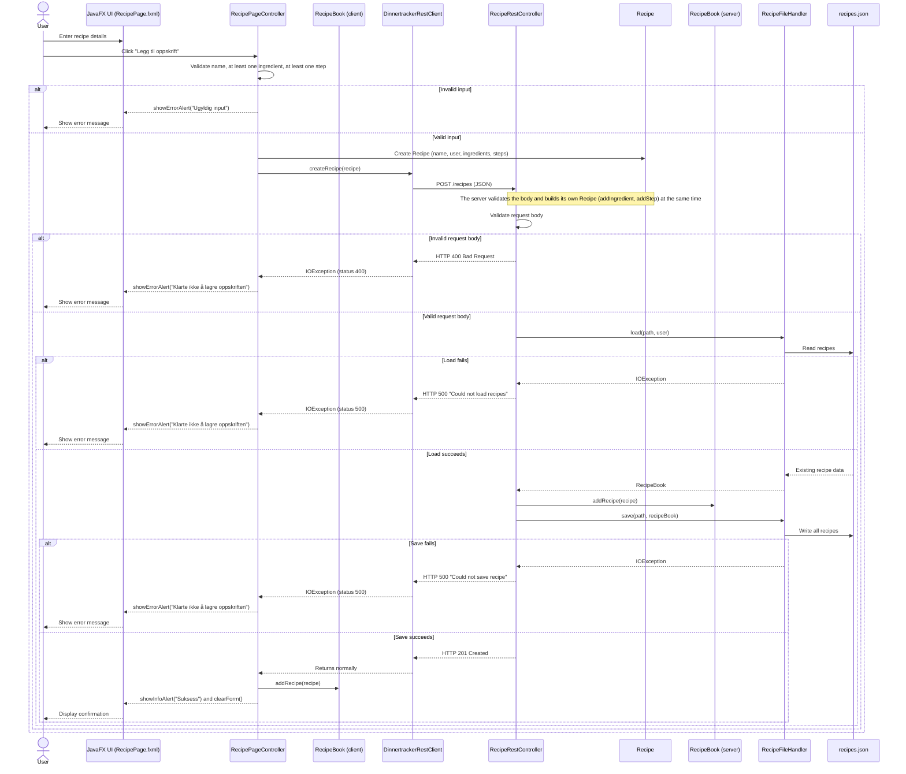

# UML Diagrams

This document presents UML diagrams that describe the structure and behaviour of Dinnertracker. It includes a package diagram, a class diagram of the most important parts of the application, and a sequence diagram illustrating an important use case.

## Package Diagram

The package diagram illustrates the main modules and packages in Dinnertracker and how they relate to each other.

<!-- Camilla: Legg til pakkediagram her! -->

## Class Diagram

The class diagram presents the most important classes in Dinnertracker and their relationships.

<!-- Camilla: Legg til klassediagram her!! -->

# Sequence diagram

## Use case: Create a recipe

The sequence diagram shows what happens when a user creates a recipe in the JavaFX client. `RecipePageController` validates the input and sends the recipe to the REST server through `DinnertrackerRestClient`. The server validates the request, loads the existing recipe book, adds the new recipe and saves the book to `recipes.json`. The client only adds the recipe to its local recipe book after the server has confirmed with HTTP 201.

If the server cannot be reached or the request times out, `DinnertrackerRestClient` throws an `IOException` before any response arrives. The controller then shows the same error alert as in the error cases above, and the recipe is not added to the local recipe book.