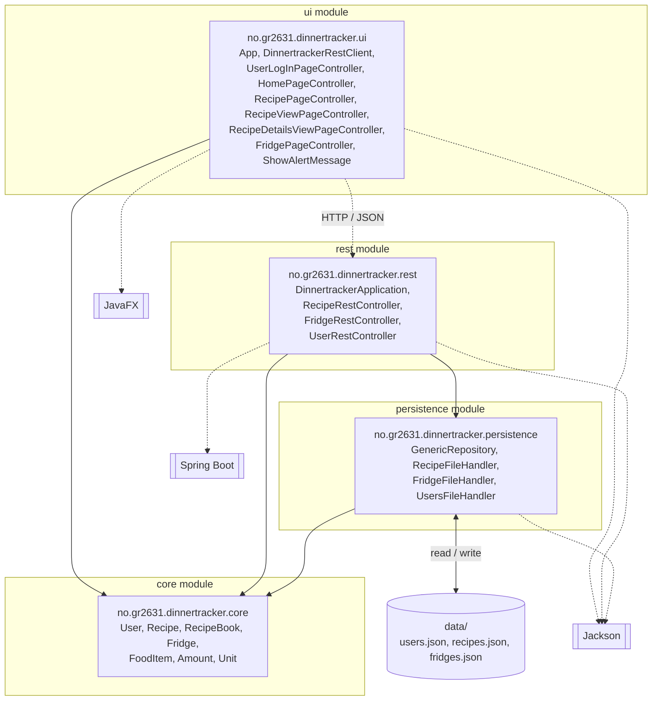
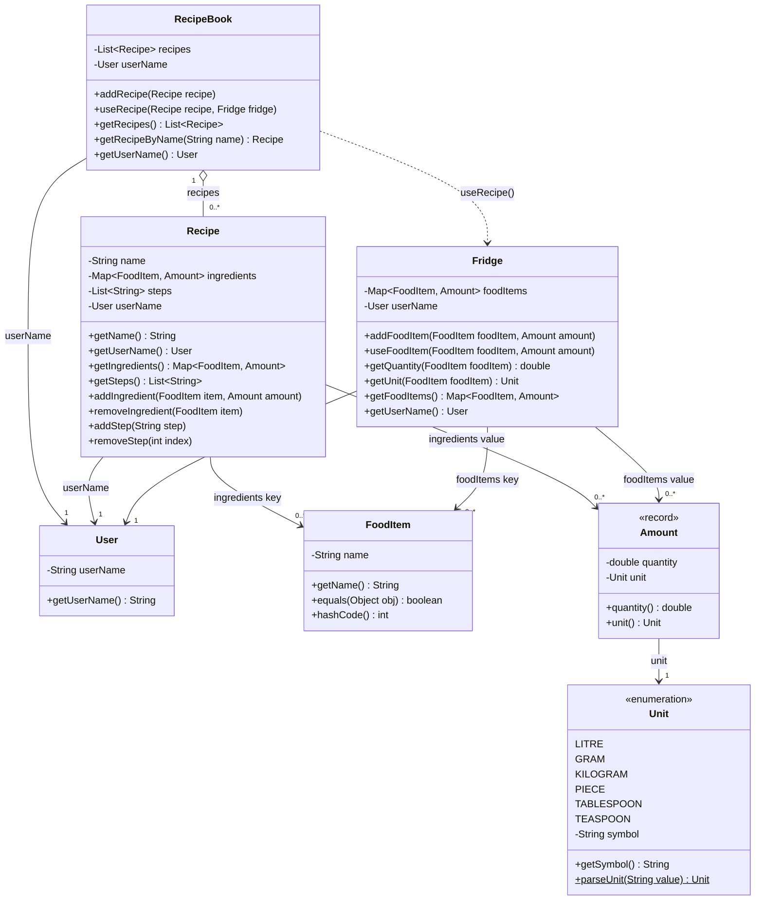
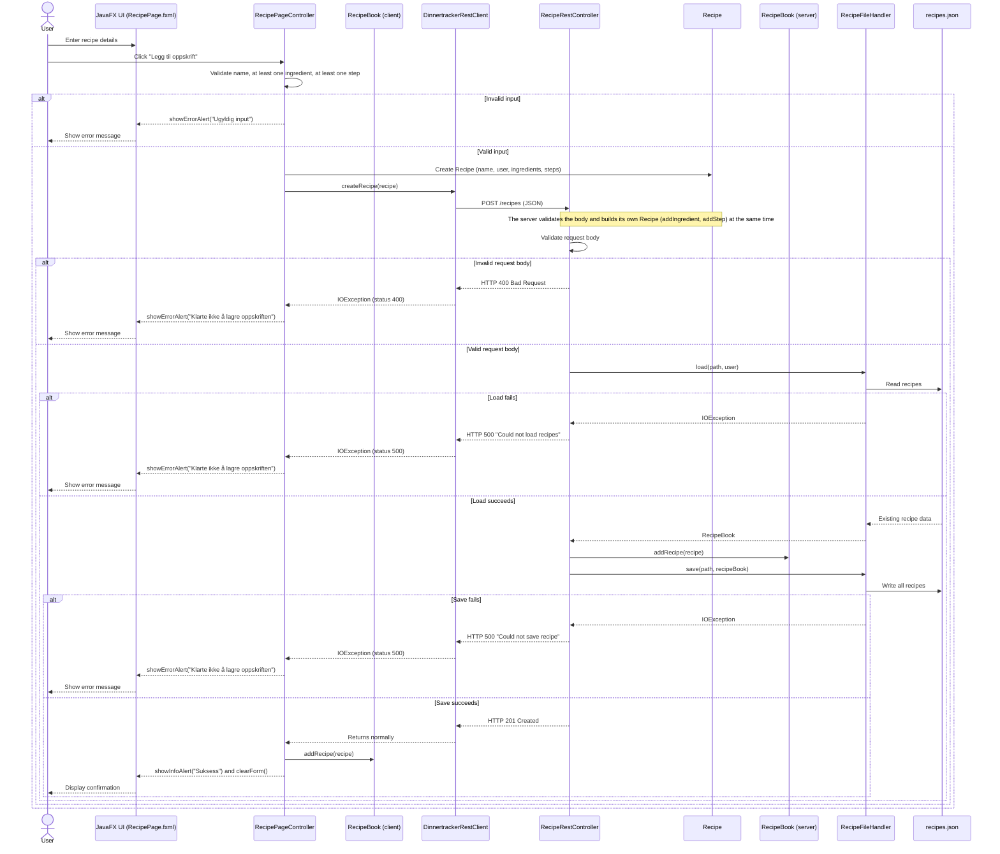

# UML Diagrams

This document presents UML diagrams that describe the structure and behaviour of Dinnertracker. It includes a package diagram, a class diagram of the most important parts of the application, and a sequence diagram illustrating an important use case.

# Package diagram

The package diagram shows the main modules and packages in Dinnertracker and the dependencies between them. Each Maven module contains one Java package:

- **`core`** contains the domain model (`Recipe`, `RecipeBook`, `Fridge`, `FoodItem`, `Amount`, `Unit`, `User`) and the application's rules. It does not depend on any other module.
- **`persistence`** saves and loads data as JSON files in `data/` using Jackson. It depends on `core`, because it converts domain objects to and from JSON.
- **`rest`** is a Spring Boot server that exposes recipes, fridges and users through HTTP endpoints. It uses `core` for the domain logic and `persistence` for storage.
- **`ui`** contains the JavaFX application and its controllers. It uses `core` for the domain objects and `DinnertrackerRestClient` to send requests to the REST server.

The arrow from `ui` to `rest` is HTTP communication, not a Java dependency. Only the REST server reads and writes the JSON files. All Java dependencies point towards `core`, and there are no cycles between the modules.

## Class Diagram
This diagram focuses on the central domain model in the `core` module. The domain model describes the concepts the application is built around: users, recipes, a recipe book, a fridge, and the food items and amounts they contain. The `core` module does not depend on JavaFX, Spring or the persistence module, so the domain logic can be used and tested independently of how data is shown or saved. The `ui`, `persistence` and `rest` modules all build on these classes.

The diagram shows the fields and public methods of each class and how the classes are related. UI controls, private helper methods (such as quantity validation) and `toString()` are left out to keep it readable.

# Sequence diagram

## Use case: Create a recipe

The sequence diagram shows what happens when a user creates a recipe in the JavaFX client. `RecipePageController` validates the input and sends the recipe to the REST server through `DinnertrackerRestClient`. The server validates the request, loads the existing recipe book, adds the new recipe and saves the book to `recipes.json`. The client only adds the recipe to its local recipe book after the server has confirmed with HTTP 201.

If the server cannot be reached or the request times out, `DinnertrackerRestClient` throws an `IOException` before any response arrives. The controller then shows the same error alert as in the error cases above, and the recipe is not added to the local recipe book.
